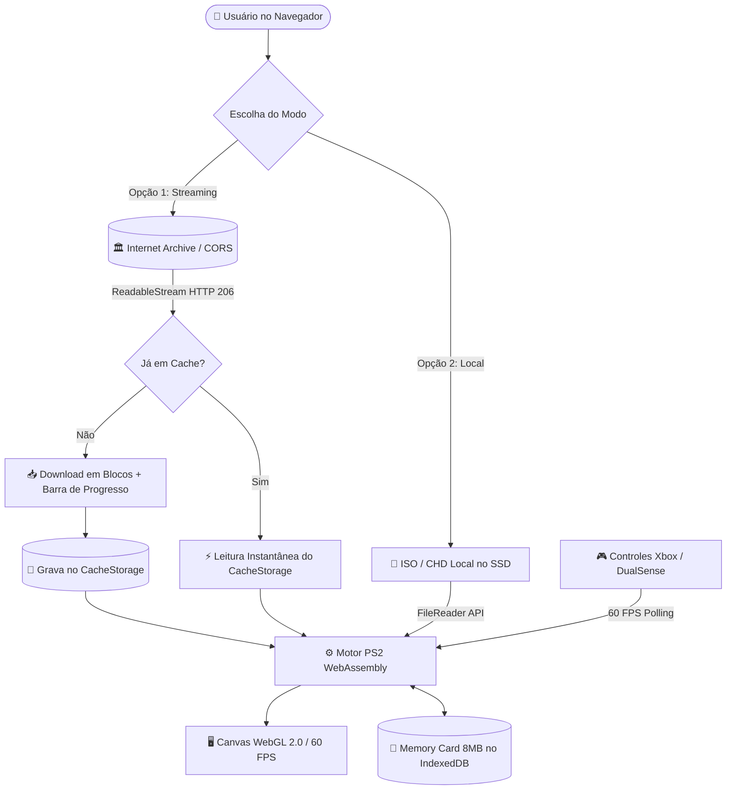

## 🌐🇧🇷 [Versão em Português do README](README.md)
## 🌐🇺🇸 [English Version of README](README_EN.md)

# ⚔️ God of War II Web - React & WebAssembly Edition 🏛️🔥

Aplicação web de alta performance construída em **React 19, TypeScript, Vite e Tailwind CSS v4** projetada para executar o lendário **God of War II** de PlayStation 2 diretamente em navegadores modernos via **WebAssembly (WASM)** e **WebGL 2.0 / WebGPU**, sem necessidade de instalação local e com custo zero de infraestrutura.

---

## 🔨 Funcionalidades do Projeto

- ⚡ **Dois Modos de Carregamento:**
  - **Chunk Streaming (Internet Archive - HTTP 206):** Baixa apenas os primeiros **150 MB** da ISO (setor de boot e fase 1 do Colosso de Rodes) para dar **boot em cerca de 10 segundos**, enquanto o restante é transmitido silenciosamente em segundo plano sem travar o jogo.
  - **Modo Local (BYOG - Bring Your Own Game):** Carregamento de arquivos `.iso` ou `.chd` do disco local via HTML5 File System API sem gastar dados de internet.
- 💾 **Persistência Dupla de Saves:**
  - **Memory Card Virtual (8MB):** Gravação dos saves nativos das colunas de luz dourada diretamente no **IndexedDB** do navegador.
  - **Cache Offline Permanente:** O jogo baixado é armazenado via **CacheStorage API**, garantindo carregamento instantâneo a partir da segunda visita.
- 🎮 **Suporte Completo a Controles (Gamepad API):**
  - Reconhecimento automático de controles de Xbox, PlayStation 4/5 (DualSense) e genéricos.
  - Polling a 60 FPS com captura suave de analógicos (movimentação e rolamento de esquiva).
  - Suporte a vibração háptica (*Dual-Rumble / Force Feedback*).
- 🖥️ **Canvas Gráfico Otimizado:** Resolução 640x448 nativa, suporte a tela cheia, alternância de áudio e atalhos rápidos de teclado.

---

### 📸 Exemplo Visual do Projeto

<div align="center">
  
</div>

---

## ✔️ Técnicas e Tecnologias Utilizadas

- **React 19 & TypeScript:** Interface reativa, modular e fortemente tipada.
- **Vite:** Ferramenta de build ultrarrápida com Hot Module Replacement (HMR).
- **Tailwind CSS v4:** Estilização com design system escuro e responsivo.
- **HTML5 Web Streams API & ReadableStream:** Download em blocos com cálculo de porcentagem e megabytes transferidos.
- **CacheStorage & IndexedDB:** Persistência no cliente de arquivos binários pesados e blocos do Memory Card.
- **HTML5 Gamepad API:** Mapeamento de analógicos, gatilhos e acionadores de vibração tátil.
- **Lucide React & Canvas Confetti:** Ícones vetoriais modernos e efeitos de comemoração ao boot do jogo.

---

## 📊 Arquitetura do Fluxo de Dados



---

## 📁 Estrutura do Projeto

- **public/**: Arquivos públicos estáticos e favicon.
- **src/**:
  - **components/**:
    - `DownloadCard.tsx`: Card de streaming do Archive com barra de progresso.
    - `LocalFileCard.tsx`: Seletor de arquivo local via File API.
    - `GameCanvas.tsx`: Container do canvas com WebGL, tela cheia e atalhos.
    - `GamepadHUD.tsx`: HUD com status do controle e botão de teste de vibração.
  - **hooks/**:
    - `useGamepad.ts`: Hook para polling do gamepad e force feedback.
  - **services/**:
    - `romDownloader.ts`: Serviço de download com streaming e cache offline.
  - **types/**:
    - `game.ts`: Interfaces de tipagem do estado do jogo e controles.
  - `App.tsx`: Orquestrador principal da interface e estados.
  - `index.css`: Configuração global de temas com Tailwind CSS v4.
  - `main.tsx`: Ponto de entrada do React 19.

---

## 🛠️ Abrir e rodar o projeto

Para iniciar o projeto localmente, siga os passos abaixo:

1. **Certifique-se de que o Node.js está instalado**:
   - O [Node.js](https://nodejs.org/) (versão 18 ou superior) é necessário para rodar o projeto. Verifique a instalação com:
     
   ```bash
   node -v
   npm -v
   ```

2. **Clone o Repositório**:
   ```bash
   git clone https://github.com/seu-usuario/God-of-War-2-Web.git
   cd God-of-War-2-Web
   ```

3. **Instale as Dependências**:
   ```bash
   npm install
   ```

4. **Inicie o Servidor de Desenvolvimento**:
   ```bash
   npm run dev
   ```
   Acesse a URL indicada no terminal (geralmente `http://localhost:5173`).

---

## 🌐 Deploy

Por ser uma aplicação SPA estática (Client-Side), o deploy pode ser feito gratuitamente em qualquer provedor de CDN global:

### 🔺 Deploy na Vercel:
```bash
npm install -g vercel
vercel
```

### 🌐 Deploy no Netlify:
Execute `npm run build` e arraste a pasta `dist/` para o painel do [Netlify Drop](https://app.netlify.com/drop).
