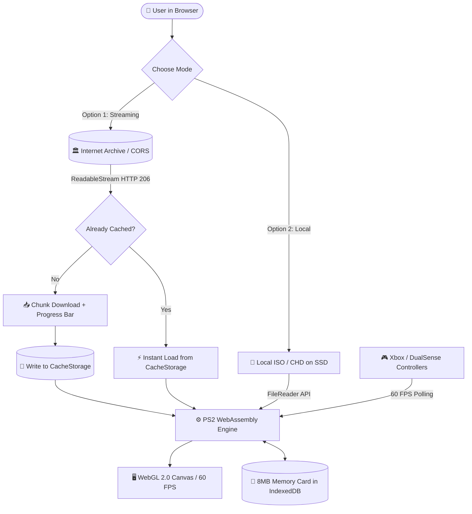

## 🌐🇧🇷 [Portuguese Version of README](README.md)
## 🌐🇺🇸 [English Version of README](README_EN.md)

# ⚔️ God of War II Web - React & WebAssembly Edition 🏛️🔥

A high-performance web application built with **React 19, TypeScript, Vite, and Tailwind CSS v4** designed to run the legendary PlayStation 2 classic **God of War II** directly in modern web browsers via **WebAssembly (WASM)** and **WebGL 2.0 / WebGPU**, requiring zero local installations and zero infrastructure hosting costs.

---

## 🔨 Project Features

- ⚡ **Dual Loading Modes:**
  - **Direct Streaming (Internet Archive):** Background download and mounting of ROM chunks via HTTP Streams (CORS enabled) without requiring local files.
  - **Local Mode (BYOG - Bring Your Own Game):** Instant loading of `.iso` or `.chd` files from the user's local SSD via HTML5 File System API without internet consumption.
- 💾 **Dual Save Persistence:**
  - **Virtual Memory Card (8MB):** Saves made at golden light columns are intercepted and written to browser **IndexedDB**.
  - **Permanent Offline Cache:** Downloaded ROM data is stored in the browser's **CacheStorage API**, ensuring 1-second instant boot from the second visit onwards.
- 🎮 **Full Gamepad Support (HTML5 Gamepad API):**
  - Automatic detection for Xbox, PlayStation 4/5 (DualSense), and generic controllers.
  - 60 FPS polling loop with smooth analog axis tracking (movement and evade rolls).
  - Haptic feedback support (*Dual-Rumble / Force Feedback*).
- 🖥️ **Optimized Graphics Canvas:** Native 640x448 resolution, full-screen toggle, audio mute/unmute, and fast keyboard shortcuts.

---

### 📸 Visual Project Example

<div align="center">
  
</div>

---

## ✔️ Techniques and Technologies Used

- **React 19 & TypeScript:** Reactive, modular, and strictly-typed UI architecture.
- **Vite:** Next-generation frontend build tool with instantaneous HMR.
- **Tailwind CSS v4:** Modern utility-first CSS styling with responsive dark theme.
- **HTML5 Web Streams API & ReadableStream:** Chunked download processing with real-time transfer progress.
- **CacheStorage & IndexedDB:** Client-side persistent binary storage.
- **HTML5 Gamepad API:** Analog stick mapping, button polling, and haptic actuator effects.
- **Lucide React & Canvas Confetti:** Clean vector icons and celebration effects upon successful boot.

---

## 📊 Data Flow Architecture



---

## 📁 Project Structure

- **public/**: Static public assets and favicon.
- **src/**:
  - **components/**:
    - `DownloadCard.tsx`: Archive streaming card with real-time progress bar.
    - `LocalFileCard.tsx`: Local file selector via File System API.
    - `GameCanvas.tsx`: Canvas wrapper with WebGL context, fullscreen, and shortcuts.
    - `GamepadHUD.tsx`: Gamepad status banner with haptic vibration test button.
  - **hooks/**:
    - `useGamepad.ts`: Custom hook for 60 FPS polling and force feedback.
  - **services/**:
    - `romDownloader.ts`: Streaming downloader and CacheStorage manager.
  - **types/**:
    - `game.ts`: TypeScript interfaces for game state, gamepad, and audio.
  - `App.tsx`: Main application orchestrator.
  - `index.css`: Global theme stylesheet with Tailwind CSS v4.
  - `main.tsx`: React 19 entry point.

---

## 🛠️ Getting Started Locally

To run the project locally, follow these steps:

1. **Ensure Node.js is Installed**:
   - [Node.js](https://nodejs.org/) (v18 or higher) is required. Verify with:
     
   ```bash
   node -v
   npm -v
   ```

2. **Clone the Repository**:
   ```bash
   git clone https://github.com/your-username/God-of-War-2-Web.git
   cd God-of-War-2-Web
   ```

3. **Install Dependencies**:
   ```bash
   npm install
   ```

4. **Start the Development Server**:
   ```bash
   npm run dev
   ```
   Open the displayed URL in your browser (typically `http://localhost:5173`).

---

## 🌐 Deployment

As a static Client-Side SPA, deploy anywhere with zero configuration:

### 🔺 Vercel Deployment:
```bash
npm install -g vercel
vercel
```

### 🌐 Netlify Deployment:
Run `npm run build` and drag the `dist/` folder into [Netlify Drop](https://app.netlify.com/drop).
